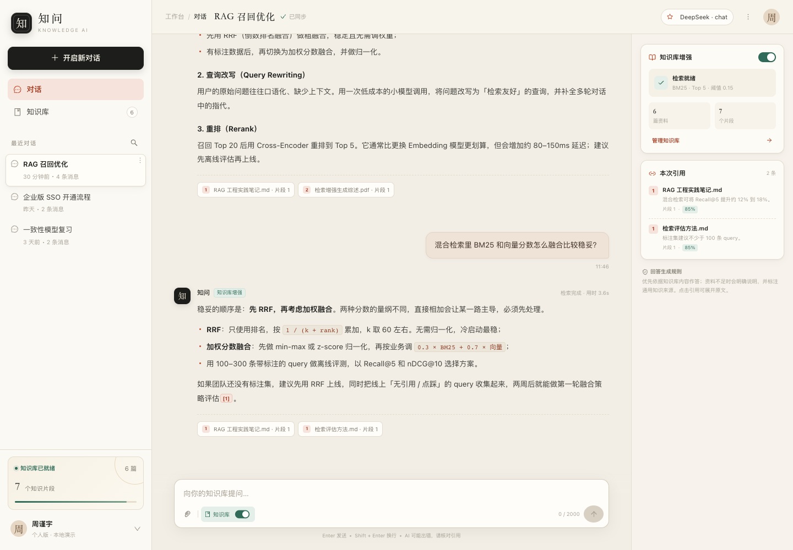
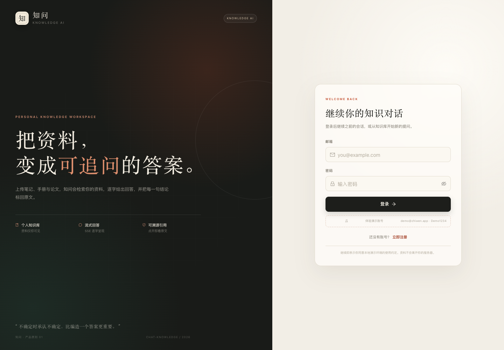
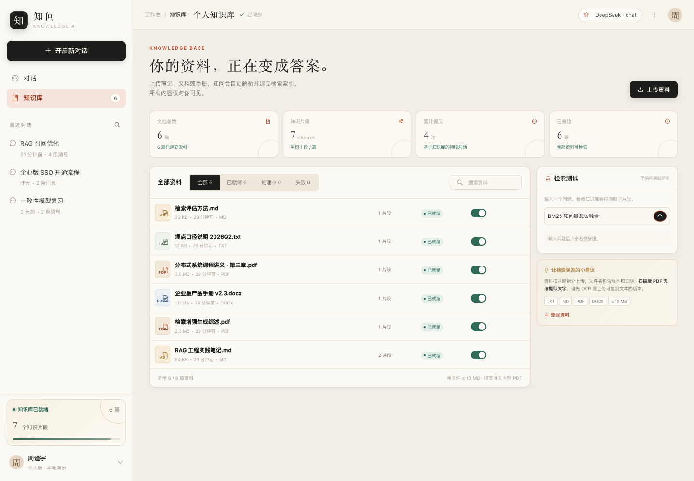

# 知问 · AI 知识问答工作台

> 把资料变成可追问、可溯源的答案。  
> React 18 + TypeScript + FastAPI + MySQL + SSE + RAG

[](https://github.com/Zjy02/chat-knowledge/actions/workflows/ci.yml)



## 这个项目解决什么问题

通用大模型能回答常识问题，但无法可靠引用「我的资料」，也容易编造细节。知问把个人资料变成可检索的知识库：

- 上传 `.pdf` / `.docx` / `.md` / `.txt`，自动解析、切分、建立索引；
- 用自然语言提问，SSE 逐字输出回答；
- 每条回答标注引用，点开即可查看原文片段；
- 保留多轮会话，可重命名、删除、刷新回放；
- 没有模型 API Key 也能启动：默认 Mock Provider 提供确定性演示回答。

**演示账号：`demo@zhiwen.app` / `Demo1234`**（执行 seed 或开启 `SEED_DEMO` 后可用）

| 登录                                          | 知识库                                                  |
| --------------------------------------------- | ------------------------------------------------------- |
|  |  |

## 技术栈

| 层       | 选型                                                                                                      |
| -------- | --------------------------------------------------------------------------------------------------------- |
| 前端     | React 18、TypeScript 5、Vite 5、React Router 6、Redux Toolkit、Ant Design 5、react-markdown、lucide-react |
| 流式通信 | **SSE**（fetch + ReadableStream + AbortController）                                                       |
| 后端     | Python 3.12+、FastAPI、Pydantic v2、SQLAlchemy 2 async                                                    |
| 数据库   | MySQL 8.4（utf8mb4），测试使用 SQLite                                                                     |
| 鉴权     | JWT HS256 + bcrypt                                                                                        |
| 检索     | jieba 中文分词 + BM25（可替换为混合检索）                                                                 |
| 文档解析 | pypdf、python-docx、纯文本                                                                                |
| 测试     | pytest + httpx、Vitest + Testing Library、Playwright                                                      |
| 工程化   | Husky、lint-staged、ESLint、Prettier、Ruff、GitHub Actions                                                |
| 部署     | Docker Compose、Nginx、MySQL volume                                                                       |

### 为什么是 SSE 而不是 WebSocket

对话是「客户端一次提交、服务端持续下行」的单向流。SSE 基于普通 HTTP，Nginx 只需关闭 buffering；`fetch` 支持 POST、Authorization 和 `AbortController`，比 WebSocket 更贴合当前需求。详见 [技术方案](docs/02-tech-design.md)。

## 快速开始

### 方式一：本地开发（无需 MySQL）

要求：Python 3.11+、Node.js 20+。

```bash
# 1. 安装依赖（会同时安装 Husky Git hooks）
make install

# 2. 写入演示数据（SQLite）
make seed

# 3. 终端 A：启动 API
make api
# http://127.0.0.1:8000/api/docs

# 4. 终端 B：启动前端
make web
# http://127.0.0.1:5173
```

默认 `LLM_PROVIDER=mock`，不需要 API Key。要接入真实模型：

```bash
cd backend
cp .env.example .env
# 编辑 .env：
# LLM_PROVIDER=deepseek
# LLM_API_KEY=sk-...
# LLM_BASE_URL=https://api.deepseek.com/v1
# LLM_MODEL=deepseek-chat
```

任何 OpenAI-compatible Chat Completions 服务都可以通过这三个变量接入。

### 方式二：Docker Compose（MySQL + Nginx）

要求：Docker 24+、Docker Compose v2。

```bash
cp .env.example .env
# 修改 .env 中的数据库密码与 SECRET_KEY
docker compose up -d --build

# 打开 http://localhost:8080
# API 文档 http://localhost:8000/api/docs
```

Compose 会启动 `mysql:8.4`、FastAPI 和 Nginx；API 容器启动时自动执行 Alembic 迁移。首次启动可设置 `SEED_DEMO=true` 创建演示账号。

> 生产环境请务必修改 `SECRET_KEY`、数据库密码，并把 `SEED_DEMO` 设为 `false`。

## 功能清单

- 邮箱注册 / 登录 / JWT 会话 / 退出登录
- 多轮会话：新建、列表、重命名、删除、历史回放
- SSE 流式回答：首字即显、停止生成、失败重试、重新生成
- Markdown：标题、列表、表格、代码高亮、引用上标
- 知识库：上传、拖拽、解析状态轮询、启停、删除、统计
- 检索测试：实时查看 BM25 命中片段与相关度
- 引用可追溯：回答内 `[1]`、来源卡片、原文弹窗、右侧引用栏
- 响应式：桌面侧栏 + 引用栏，移动端抽屉式导航
- 错误与空状态、Toast、加载骨架、键盘可达

## 项目结构

```text
chat-knowledge/
├── backend/
│   ├── app/
│   │   ├── api/routes/      # auth / conversations / chat / knowledge / health
│   │   ├── core/            # config, security, middleware, rate limit
│   │   ├── db/              # async engine, session, declarative base
│   │   ├── models/          # User / Conversation / Message / Document / Chunk
│   │   ├── schemas/         # Pydantic v2 request & response
│   │   ├── services/        # chat, retrieval, llm, document parsing
│   │   └── scripts/seed.py  # demo data
│   ├── alembic/             # schema migrations
│   ├── tests/               # 26 pytest tests
│   └── Dockerfile
├── frontend/
│   ├── src/
│   │   ├── api/             # fetch client + SSE parser
│   │   ├── components/      # Markdown, dialogs, toasts
│   │   ├── features/        # auth / chat / knowledge
│   │   ├── store/           # Redux Toolkit slices + typed hooks
│   │   ├── styles/          # design tokens + responsive CSS
│   │   └── types/
│   ├── e2e/                 # Playwright main-flow regression
│   └── Dockerfile
├── docs/                    # requirements / tech design / test / deployment
├── docker-compose.yml
├── .github/workflows/ci.yml
└── Makefile
```

## 测试与质量

```bash
make test          # 后端 pytest + 前端 Vitest
make test-e2e      # Playwright：注册 → 提问 → 上传 → 引用 → 重命名 → 刷新回放
make check         # lint + typecheck + tests + production build
```

当前结果：

| 检查                     | 结果                   |
| ------------------------ | ---------------------- |
| 后端 pytest              | 26 passed，覆盖率 87%  |
| 前端 Vitest              | 16 passed              |
| Playwright E2E           | 1 passed（完整主链路） |
| Ruff / ESLint / Prettier | 全部通过               |
| TypeScript / Vite build  | 通过                   |

详见 [测试报告](docs/04-test-report.md)。

## 工程化约定

- **Husky**：提交前执行 `lint-staged`（ESLint + Prettier），推送前执行 TypeScript 类型检查。
- **ESLint**：TypeScript + React Hooks + React Refresh 规则，`--max-warnings 0`。
- **Prettier**：统一引号、分号、行宽；`npm run format:check` 纳入 CI。
- **Redux Toolkit**：认证、会话、知识库和 UI 状态统一管理，异步请求使用 `createAsyncThunk`。
- **Ant Design 5**：表单、弹窗、表格、上传、Switch、Dropdown、message 等交互组件；品牌样式通过 `ConfigProvider` 与 `styles/antd.css` 统一覆盖。
- **Ruff**：Python lint，CI 与本地 `make lint` 均执行。
- **注释原则**：解释「为什么」而不是重复代码；Python 侧重点注释异步会话、SSE 生命周期、检索归一化、后台解析与安全边界。

详见 [工程化说明](docs/06-engineering.md)。

## 文档

- [需求分析](docs/01-requirements.md)
- [技术方案](docs/02-tech-design.md)
- [API 契约](docs/03-api-contract.md)
- [高保真原型](docs/prototype/index.html)
- [测试报告](docs/04-test-report.md)
- [部署手册](docs/05-deployment.md)
- [工程化说明](docs/06-engineering.md)
- [验收清单](docs/07-acceptance.md)

## 已知边界与后续规划

- v1 是单用户单知识库；表结构已按 `user_id` 隔离，可扩展多知识库/团队空间。
- 检索使用 BM25，专有名词与版本号表现稳定；后续可在 `search_chunks` 后接入向量召回 + RRF 混合检索。
- 文档解析使用 FastAPI BackgroundTask，适合单实例；规模化时替换为 Celery/RQ + 对象存储。
- 速率限制是进程内实现；多 worker 部署时替换为 Redis。
- 仅支持文本型 PDF；扫描件需先 OCR。
- 真实 LLM 链路的错误码、超时与重试已封装，但需要配置有效 API Key 才能做在线质量评估。

## License

MIT
